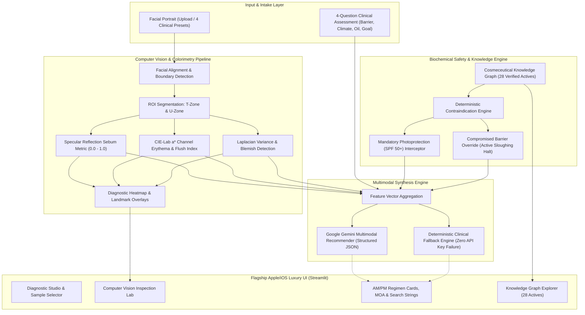

# 🔬 SkinnAlgo: Multimodal Skin Condition Intelligence & Cosmeceutical Compound Recommender

[](https://www.python.org/)
[](https://docs.pytest.org/)
[](https://opencv.org/)
[](https://streamlit.io/)
[](https://ai.google.dev/)
[](https://opensource.org/licenses/MIT)

> **Commercial-grade BeautyTech Applied AI Decision Engine**: Quantifies dermatological surface properties (Sebum, Erythema in CIE-Lab, Texture Roughness, Blemish Density) across segmented T-Zone and U-Zone facial landmarks. Fuses quantitative CV metrics with a dynamic clinical questionnaire, enforces a **deterministic chemical contraindication rule engine**, and synthesizes evidence-based active skincare chemical regimens via Google Gemini.

---

## 📌 Project Overview & Philosophy

**SkinnAlgo** does **NOT** diagnose medical pathology. It functions as an evidence-based, personalized **cosmeceutical decision engine** that recommends exact chemical compound names (e.g., *2% Salicylic Acid*, *5% Niacinamide*, *Physiological Ceramides NP/AP/EOP*, *3% Tranexamic Acid*) with concentrations, biochemical Mechanisms of Action (MOA), and copyable product search strings.

### Key Pillars:
1. **👁️ Physics-Based Computer Vision & Colorimetry**: Decouples melanin pigmentation from vascular erythema using CIE-Lab $a^*$ chrominance modeling, isolates specular reflection for sebum, and detects micro-relief roughness with high-pass Laplacian operators.
2. **📋 Clinical Intake Cross-Validation**: Reconciles subjective sensory intake with objective CV metrics (e.g., detecting *Dehydrated-Oily* barrier degradation when tightness coincides with high sebum).
3. **🧪 Deterministic Safety Constraint Satisfaction**: Hard-coded rule graph that strictly intercepts hazardous ingredient collisions (Retinoid + AHA/BHA, Benzoyl Peroxide + Vitamin C redox clash, and mandatory broad-spectrum SPF 50+ lock).
4. **🤖 Multimodal Synthesis via Google Gemini**: Fuses continuous metric vectors and pre-cleared chemical candidates into structured AM/PM routines with zero hallucinated hazards.
5. **💎 Apple/iOS Luxury UI**: Ultra-clean obsidian dark glassmorphism aesthetic, Plus Jakarta typography, serif accents, and zero messy emoji clutter.

---

## 🏗️ System Architecture



---

## 🧪 Cosmeceutical Knowledge Graph (28 Verified Actives)

SkinnAlgo indexes 28 verified clinical cosmeceutical compounds categorized with biochemical Mechanisms of Action (MOA), pH stability ranges, and photosensitizing flags:

| Category | Chemical Compounds | Typical Concentration | Key Target Indication |
|---|---|---|---|
| **Keratolytics & BHA** | Salicylic Acid | 2.0% | Follicular comedones & hyperseborrhea |
| **Retinoids** | Micronized Adapalene, Retinol, Retinaldehyde | 0.1% / 0.3% / 0.05% | Normalizes keratinization, pro-collagen synthesis |
| **Oxidizing Antimicrobial** | Benzoyl Peroxide | 2.5% - 5.0% | Aerobic lysis of Cutibacterium acnes |
| **Dicarboxylic Acid** | Azelaic Acid | 10.0% - 15.0% | Erythema, rosacea, inflammatory papules |
| **Sebum Regulators** | Niacinamide (Vitamin B3), Zinc PCA | 3.0% - 5.0% / 1.0% | 5-alpha reductase suppression, ceramide upregulation |
| **Stratum Corneum Lipids** | Physiological Ceramides (NP, AP, EOP 3:1:1), Squalane | 3:1:1 Molar Ratio | Lipid lamellae reconstruction, TEWL suppression |
| **Pigment & Melanin Control** | Tranexamic Acid, Alpha Arbutin, Ethyl Ascorbic Acid | 3.0% / 2.0% / 10.0% | UV plasmin blocking, tyrosinase inhibition |
| **Direct Antioxidant** | Pure L-Ascorbic Acid (Vitamin C) | 15.0% | Singlet oxygen neutralization, prolyl hydroxylase cofactor |
| **AHA & PHA Exfoliants** | Glycolic Acid, Lactic Acid, Mandelic Acid, Gluconolactone | 5.0% - 10.0% / 4.0% | Desmosome chelation, micro-relief smoothing |
| **Soothing & Peptides** | Centella Asiatica (Madecassoside), Panthenol (B5), Ectoin, Colloidal Oat, Copper Tripeptide-1 | 1.0% - 5.0% | Downregulates IL-1β/TNF-α, osmoprotection, collagen renewal |

---

## 🛡️ Deterministic Safety Rules

1. **Retinoid + Chemical Exfoliant Collision**: Co-application of Adapalene/Retinol with strong AHA/BHA (Glycolic/Salicylic) in the same PM routine is intercepted to prevent acute barrier rupture and chemical contact dermatitis.
2. **Benzoyl Peroxide + Pure L-Ascorbic Acid Redox Clash**: Intercepts the oxidation of Ascorbic Acid into inactive, pro-inflammatory dehydroascorbic acid; substitutes stabilized non-acidic Vitamin C ethers (Ethyl Ascorbic Acid).
3. **Compromised Barrier Override**: Automatically intercepts direct chemical peeling acids if barrier sensitivity is fragile or Erythema Index > 0.40, enforcing a 14-day lipid restoration protocol (Ceramides 3:1:1 + Panthenol + Cica).
4. **Mandatory Broad-Spectrum SPF 50+ PA++++**: Non-negotiable morning step whenever photosensitizers (Retinoids, AHAs, Ascorbic Acid) are part of the regimen.

---

## 🚀 Quickstart & Installation

### 1. Clone & Set Up Environment
```bash
git clone https://github.com/your-username/SkinnAlgo.git
cd SkinnAlgo

# Create virtual environment
python -m venv venv
# Windows:
.\venv\Scripts\activate
# Linux/macOS:
source venv/bin/activate

# Install production dependencies
pip install -r requirements.txt
```

### 2. Run Automated PyTest Suite
Run the 36-test suite covering colorimetry, sebum metrics, texture variance, and safety rules:
```bash
pytest
```
*Expected output: `36 passed in ~1.0s (100% green)`.*

### 3. Launch Streamlit Application
```bash
streamlit run app.py
```
Open your browser to `http://localhost:8501`.

---

## 💼 Technical Interview Preparation Guide
Preparing for technical interviews in Applied AI, Computer Vision, or LLM Systems?
Read [`INTERVIEW_PREP.md`](./INTERVIEW_PREP.md) for detailed mathematical derivations, physics of CIE-Lab colorimetry, deterministic vs neuro-symbolic safety architectures, and 10 anticipated technical interview questions with model answers.

---

## 📄 License
This project is licensed under the MIT License — see the [LICENSE](LICENSE) file for details.

